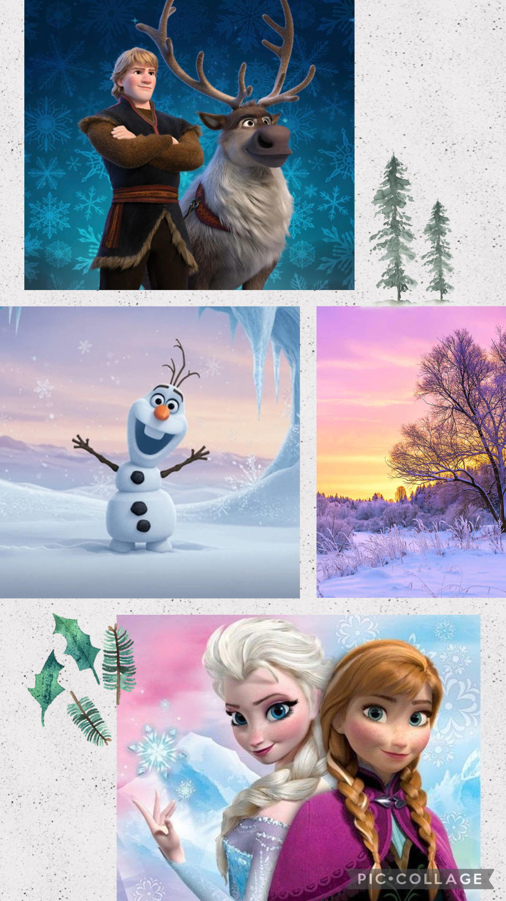

# concept-film
# Olaf: Au-delà du coeur

Projet conçu en équipe avec : Abir Amoucha

## Le concept et l'audience

- Une phrase (logline) : Olaf veut accompagner Anna dans sa mission de sauver Elsa, mais il doit traverser la montagne.
- Le public cible : G (général)
- La franchise d'origine : La reine des neiges 1

## L'intrigue

- Le début : Olaf est un bonhomme de neige créé par Elsa. Il rêve de découvrir l’été et de vivre de nouvelles aventures.
- Le milieu : Olaf accompagne Anna et Kristoff dans leur voyage à travers la montagne pour retrouver Elsa. Il découvre le monde et aide ses amis.
- Le revirement (plot twist) : Olaf découvre que l’amour véritable peut prendre différentes formes et comprend qu’Anna et Elsa ont besoin l’une de l’autre.
- La fin : Olaf aide Anna et Elsa à se retrouver. Grâce à la magie d’Elsa, il peut continuer à vivre même lorsqu’il fait chaud.

## Le personnage principal

- Description (physique et psychologique) :
    - bonhomme de neige
    - amour inconditionnel
    - naif
    - curieux
- Son désir (ce qu'il veut) : Découvrir l’été et voir le monde en dehors de la neige.
- Son besoin (ce qu'il lui faut) : Comprendre l’importance de l’amitié et de l’amour.
- Son évolution : Olaf reste joyeux et curieux, mais il devient plus attentionné et comprend mieux ce que signifie aimer ses amis.

## L'univers

- Où et quand se passe l'histoire : Dans le royaume d’Arendelle, à une époque ancienne, pendant un hiver magique.
- Un élément de folklore qui rend l'univers vivant : : La magie de la neige et les pouvoirs d’Elsa qui donnent vie à Olaf.

## La direction cinématographique

- La palette de couleurs : Le blanc, le bleu clair et l’orange, pour représenter la neige, la glace et le nez-carotte d’Olaf.
- L'éclairage : Une lumière douce pour montrer le côté joyeux et innocent d’Olaf.
- Le rythme du montage : Un rythme dynamique et amusant, avec des scènes rapides pendant ses aventures et des scènes plus lentes pendant les moments touchants.

- Un moodboard (3 à 5 images de référence) :

